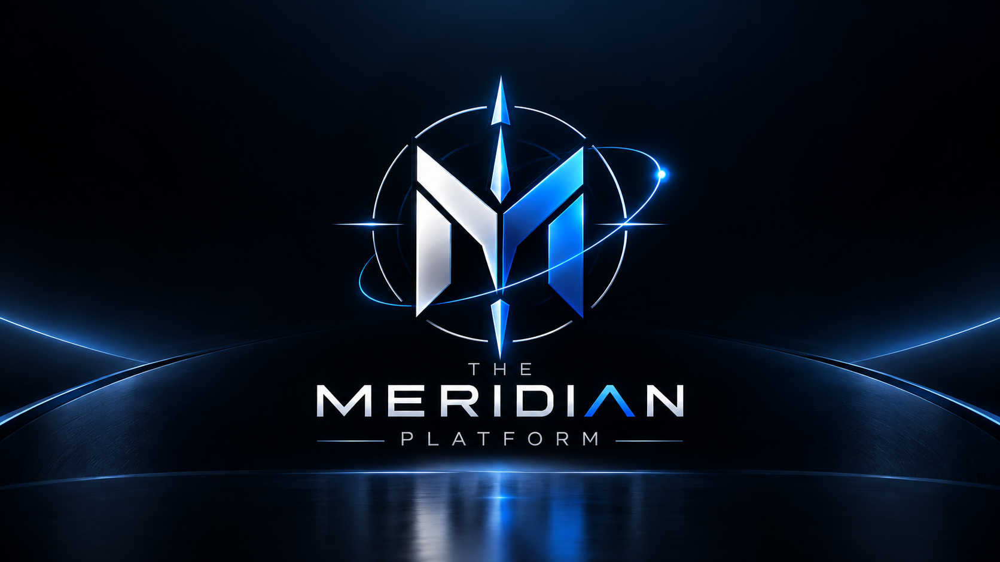

# 🔎 Meridian Search Platform

> High-performance OSINT reconnaissance backend & real-time streaming engine built with .NET 10 and C#.

Meridian is an OSINT search workspace that concurrently queries intelligence providers (Cloudflare DoH, ICANN RDAP/Whois), aggregates results via lock-free in-memory channels, batches storage into PostgreSQL (`jsonb`), and streams live findings to a modern WPF desktop client via **gRPC Server Streaming**.

---

## ⚡ Highlights

- 🏎️ **Ultra-Fast & Concurrent:** Fan-Out / Fan-In architecture powered by `System.Threading.Channels` cuts search time in half.
- 📡 **Real-Time gRPC Streaming:** Instant live feed of discovered OSINT cards to clients via HTTP/2 Protobuf streams.
- 🐘 **PostgreSQL Batching:** Zero per-item transaction lockups; high-throughput multi-row inserts with JSONB storage.
- 🏛️ **Clean Architecture & DDD:** Domain-driven design, value objects, and Result pattern (`CSharpFunctionalExtensions`).
- 📚 **Interactive API Docs:** Built-in Scalar API Reference at `/scalar/v1`.
- 🖥️ **Modern Desktop Client:** Fluent Dark-mode Windows desktop client built with WPF and `WPF-UI`.

---

## 🌐 Documentation / Документация

- 🇬🇧 **[English Documentation](mds/README.en.md)** (Full architecture, roadmap, quickstart)
- 🇷🇺 **[Документация на русском](mds/README.ru.md)** (Полная архитектура, дорожная карта, запуск)

---

## 📄 License

Dual-licensed under **GNU AGPLv3** (Free & Open Source) and **Commercial License**. See [LICENSE](LICENSE) for details.

---

_Please use OSINT sources responsibly and in compliance with applicable law._
